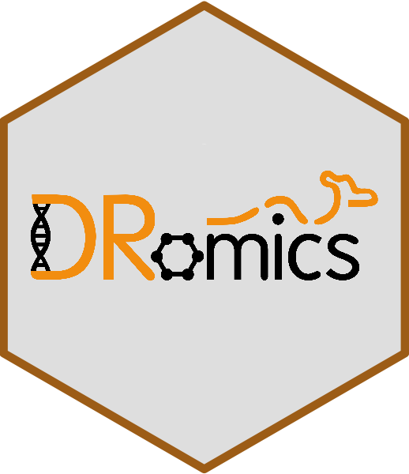
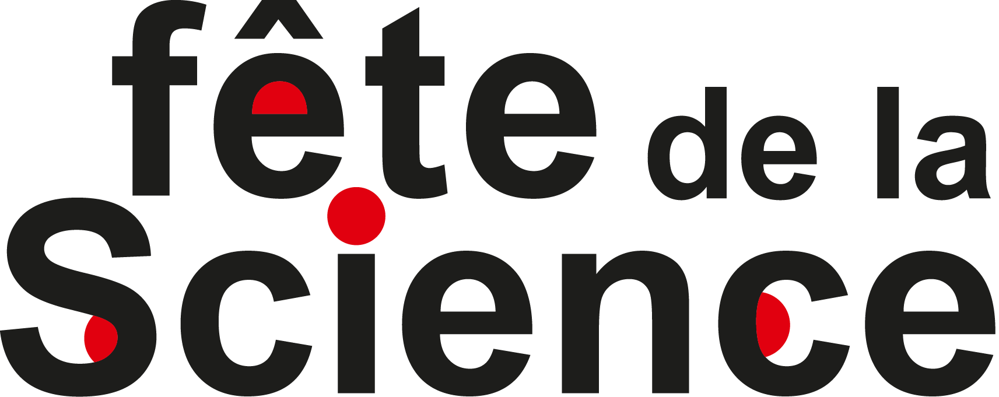
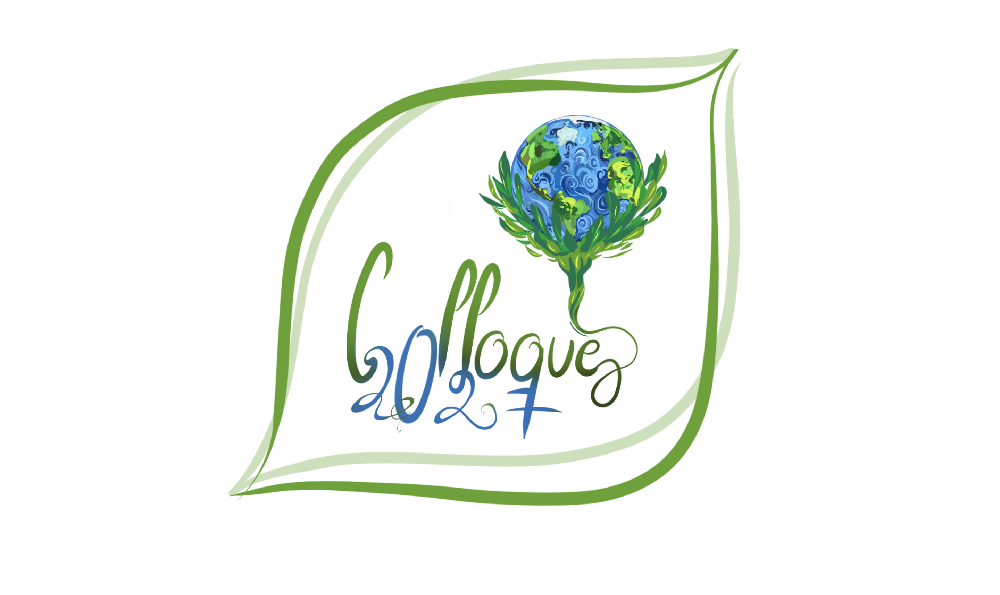

Master 2 student in Environment management - ***Ecotoxicology***

## *Educational background*

**Master in Environmental Management** [2025 --- 2027]{.cvdate}   *Université de Lorraine, Metz* [{height="30"}](https://www.univ-lorraine.fr/)  

- Ecotoxicology \| biomodelling \| biostatistics \| ecosystem functions and biodiversity \| trophic chains
  - Focus on biomodelling and POPs

**Bachelor in Life Sciences** [2023 --- 2025]{.cvdate}   *Université de Toulouse* [{height="28"}](https://www.utoulouse.fr/) [30^th^/133]{.cvdate}  

- Itinerary: Biodiversity and environmental biology (BBE) --- Ecology, phylogeny \| zoology \| parasitology \| ecophysiology \| animal ecology \| behavioural ecology \| entomology \| genetics
  - Ecotoxicology option (14.5/20)
  - Quantitative biology (2^nd^/130)
  - Animal biology (18^th^/185)
  - Scientific approach (12^th^/181)
  - Genomics (21^st^/105)
  - Animal developmental biology (31^th^/196)
  - Ethnobotanics (15,25/20)

**Bachelor in Life Sciences** [2022 --- 2023]{.cvdate}   *Faculté des Sciences de Montpellier*[{height="45"}](https://sciences.edu.umontpellier.fr/) [{height="45"}](https://www.umontpellier.fr/) [87^th^/440]{.cvdate}  

- Itinerary: Environment Sciences --- Ecosystems, organisms, molecular biology, cellular biology, chemistry
  - Integrated biology of marine mammals (1^st^/56)
  - Biomechanics option (14^th^/114)

**2021-2022** : **Baccalaureate** [2021 --- 2022]{.cvdate}  

- specialty Life & Earth sciences (18/20) & Chemistry & Physics (17/20)

## ***Internships***

**Master 2 research internship** [*feb --- jul 2027*]{.cvdate}  

> **Title**: *Predicting PFOS contamination in coral reef fish* Chrysoptea cyanea *using transcriptomic laboratory data* via *conditional inference tree models.*

The internship consists in using oral PFOS contamination transcriptomic response data produced by Emma GAIRIN during her PhD at OIST to predict environmental concentration and effects in C. cyanea, a potentially useful way of reducing costs of biomonitoring\

**Master 1 research internship** [*may --- jun 2026*]{.cvdate}  

> **Title**: *Critical analysis of environmental indicators used in the computing of E.S.G. scores’ environmental relevance.*

As E.S.G. (environmental, social and governance) scores are of growing importance in investment decision making, an assessment of the relevance of the environmental indicators used by three audit agencies was conducted. Ecological and ecotoxicological indicators were studied and showed a lack of correlation between a company’s score and actual environmental risks.

**Licence 2 internship** [*may --- jun 2024*]{.cvdate}   Creation of scientific workshops and participation in other. About ecology, evolution, functional traits and basic chemistry and physics in the scientific communication association *Délires d’encre.*

## ***Curriculum projects***

- **2^nd^ semester**: Bibliographical Synthesis about orcas contamination, particularly with PCB.
- **4^th^ semester**: **Practical study** on micro-forests efficiency (*Miyawaki*) on restoring biodiversity. Sampling (*pitfall traps*) and statistical analysis.
- **5^th^ semester**:
  - Bibliography on PFOA and *DuPont de Nemours*^©^ scandal about Teflon in West Virginia (USA).
  - Epistemologic research about cellular senescence in evolutionary biology
- **6^th^ semester**: Risk assessment on glyphosate and AMPA, their toxicity and their environmental fate. A bibliographical analysis.
- **7^th^ semester**:
  - In class **study project** on effects of two stress factors, temperature increase and nitrate contamination on *Myriophyllym spicatum*. Experimenting and statistical analysis.
  - Two Bibliographic synthesis: Persistent organic pollutants (POPs) in the grand cycle of water; Bio-based versus traditional plastics: a comparative toxicity and degradability assessment.
- **8^th^ semester**: In class **study project** on PVC rainwater leaching on worm *Eisenia fetida* at different pH and PVC concentrations. Experimenting and statistical analysis.

## ***Skills***

### Programming and computing

- **Main languages**: R (advanced) [{height="27"}](https://www.r-project.org/), python (beginner)
- **GIS**: Qgis and ArcGIS pro [{height="27"}](https://www.qgis.org/)
- **Reproducible research**: Quarto [{height="27"}](https://quarto.org/), R Markdown [{height="27"}](https://www.markdownguide.org/), Git (Github) [{height="27"}](https://git-scm.com/)
- **Documents**: HTML, (S)CSS, Markdown, LaTeX (basics)

### Data processing

- **Main inferential statistical tests**
- **Dose-response modeling:** selection of significantly responsive items, model fitting and selection, EC~*X*%~ and benchmark doses (BMD) computation.
- **Predictive statistics:** ANOVA, linear regression, non-linear models, GLM
- **Multivariate analysis:** trees, PCA, correspondence analysis
- **Data representation:** R base and ggplot2 [{height="30"}](https://ggplot2.tidyverse.org/)

### Ecotoxicological testing

- **Standard tests:**
  - *Daphnia magna* (ISO 6341),
  - Ames (ISO 16240)
  - Germination (ISO 18763)
  - Algae *Raphidocelis subcapitata* (ISO 8692)
  - Cellular bioluminescence *Vibrio fischeri* (ISO 11348)
  - Earthworm *Eisenia fetida* (ISO 17512-1)
- RT-qPCR
- Bradford protein assay
- **Bases of transcriptomics and omics in general:** theory and data analysis with gene selection, benchmark doses determination and graphical representations. [{height="40"}](https://drgarden.pages.in2p3.fr/DRomics/articles/DRomics_vignette.html)
- Mussel dissection (*Dreissena polymorpha*)
- *Myriophyllum* and earthworm cultivation

### Ecological testing

- **Ecosystem functions testing:** assimilative capacity, respiration, primary production and consumption, decomposition.

### General Skills

- Scientific protocol thoroughness (multi-stress --- complex experimental designs)
- Communication skills
- Meticulous drafting and thoroughly annotated scripts and protocols
- Adaptation and teamwork

## Additional

- Image editing: Photoshop, Inkscape, ClipStudio Paint, Krita

## Languages

- French --- Native 🇫🇷
- English C1 (TOEFL, TOEIC) 🇬🇧
- Japanese (conversational) 🇯🇵
- Spanish 🇪🇸

## Science communications

- **Fête de la science:** Organized a 3 day long event targeted at school children in a scholar context and then a public setting. The event was about explaining key principles of predator-prey dynamics and modeling. – LIEC, Lorraine University, in 2025 and 2026. [{height="30"}](https://factuel.univ-lorraine.fr/fete-de-la-science/)

:::{.callout-note collapse="true"}
This was a fantastic opportunity for me to get immersed again in Lotka-Volterra equations whilst learning to better raise awareness among children
:::

- Organization of a **symposium** about forests and climate change as part of the communication team, and gave a presentation about forest fire management PFAS foams ecotoxicology – LIEC, Lorraine University, in 2027 {height="40"}
- Conducted a month-long **scientific communication** internship which allowed me to acquire knowledge transmission skills.

------------------------------------------------------------------------
